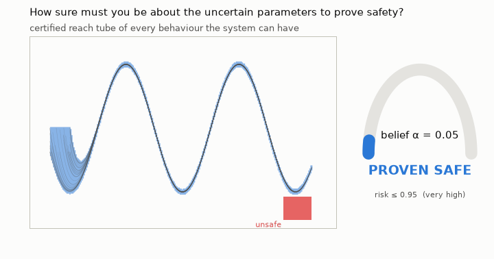
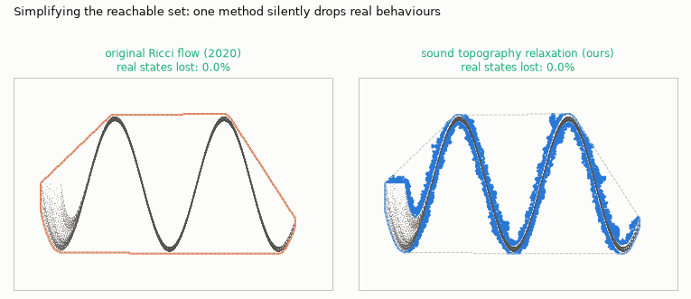
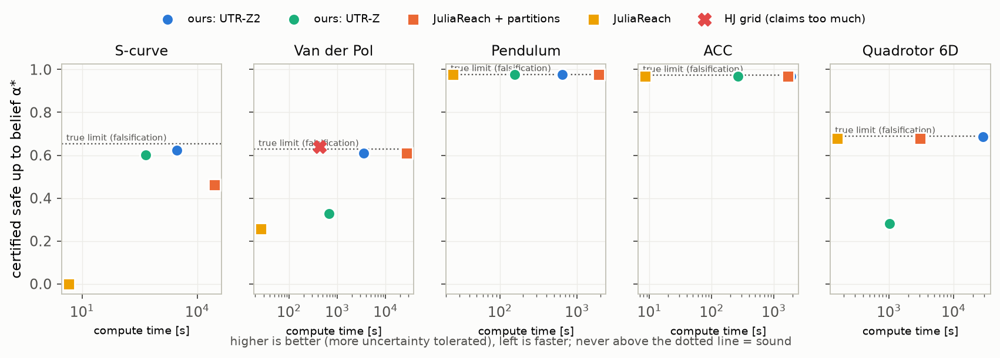

# Uncertain Fuzzy Ricci Reachability

**Prove that a system is safe — and say how sure you need to be.**



Uncertain parameters (a mass, a delay, a wind gust) are rarely known precisely. They are
*believed*. This project certifies safety for **every** behaviour consistent with those
beliefs and reports the answer as a dial: *safe up to belief α\**, with a plain-language
risk label. Turning the dial up widens the set of behaviours. The verdict flips at the
exact belief level where safety can no longer be guaranteed.

## Simplifying without losing anything



Reachable sets are hard to read, so people simplify them. An earlier curvature-flow
approach dropped **30% of the real behaviours** while simplifying (red points, left).
The relaxation used here never loses one (right).

## How it compares



Each point is a certificate: higher means more uncertainty tolerated, left means faster.
Nothing may sit above the dotted line, which is the limit found by searching for real
failures; a point above it would claim safety that does not hold.

| system | ours (UTR-Z2) | JuliaReach (TMJets) | JuliaReach + partitions | falsification limit |
|---|---|---|---|---|
| S-curve (2D) | **0.624** | 0.000 | 0.461 | 0.654 |
| Van der Pol, 7 s | **0.609** (≈1 h) | 0.258 | 0.609 (≈7.6 h) | 0.628 |
| planar quadrotor (6D) | **0.687** | 0.679 | 0.679 | 0.689 |
| Duffing chain N=4 (10D) | **0.859** | fails | fails | 0.864 |
| ACC / pendulum | tie (0.968 / 0.976) | tie | tie | 0.974 / 0.978 |

- **Grid-based Hamilton–Jacobi reachability** reports 0.64–0.85 on Van der Pol, which is
  *above* the falsification limit. It claims safety that does not hold.
- **Times:**
  - every engine reaches the same certificate on ACC and the pendulum, and plain
    JuliaReach is the fastest there;
  - on the quadrotor, ours takes about 8 hours where plain JuliaReach takes 3 minutes;
  - all times are listed in `experiments/results/`.

## Run it
```
python -m venv .venv && .venv/Scripts/pip install -r requirements.txt
.venv/Scripts/python -m pytest -q tests                  # 42 soundness and unit tests
cd experiments
../.venv/Scripts/python run_paper1.py pendulum zono 512    # one certificate -> results/*.json
../.venv/Scripts/python visuals.py                         # the animations and the scoreboard
```
JuliaReach baseline (Julia 1.10 LTS): `cd julia && julia +lts install.jl`, then
`julia +lts --project=. juliareach.jl van_der_pol none 512`.

| path | content |
|---|---|
| `frs/` | library: interval arithmetic and AD, uncertain variables, benchmark systems, reachability engines, falsification, relaxation |
| `experiments/` | run scripts, `results/*.json`, `figs/` |
| `julia/` | JuliaReach / TMJets baseline under identical settings |
| `tests/` | unit and containment-soundness tests |

## License
MIT (see `LICENSE`). Third-party dependencies are listed in `NOTICE.md`.
