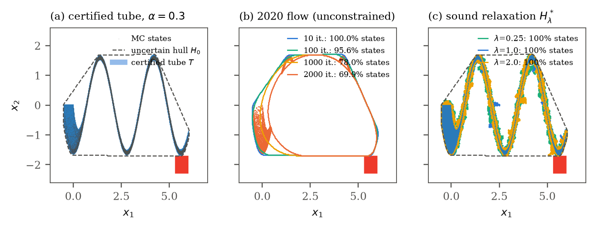

# Uncertain Fuzzy Ricci Reachability: experiments

Experiment code and results for belief-graded safety verification of uncertain
dynamical systems. Each run reports the largest belief level α* at which the system is
certified safe.



## Layout
| path | content |
|---|---|
| `frs/` | library: interval arithmetic and interval AD, uncertain variables, benchmark systems, reachability engines, falsification, relaxation |
| `experiments/` | run scripts, `results/*.json` (one file per run), `figs/` |
| `julia/juliareach.jl` | JuliaReach / TMJets baseline runs under the same settings |
| `tests/` | unit and containment-soundness tests |

## Setup and run
```
python -m venv .venv && .venv/Scripts/pip install -r requirements.txt
.venv/Scripts/python -m pytest -q tests
cd experiments
../.venv/Scripts/python run_paper1.py pendulum zono 512   # one run -> results/*.json
../.venv/Scripts/python launch_all.py 20                  # all runs
```
JuliaReach baseline (Julia 1.10 LTS):
```
cd julia && julia +lts install.jl
julia +lts --project=. juliareach.jl van_der_pol none 512
```

## Results so far (work in progress)
Certified α* (sound; higher is better) against the falsification inner bound:

| system | UTR-Z | UTR-Z2 | JuliaReach | JuliaReach + uniform split | falsification |
|---|---|---|---|---|---|
| ACC (3D) | 0.968 | 0.968 | 0.968 | 0.968 | 0.974 |
| pendulum (2D) | 0.976 | 0.976 | 0.976 | 0.976 | 0.978 |
| S-curve (2D) | 0.601 | **0.624** | 0.000 | 0.461 | 0.654 |
| S-curve pocket | 1.000 | 1.000 | 0.991 | 1.000 | 1.000 |
| Van der Pol, 7 s | 0.328 | **0.609** | 0.258 | 0.609 | 0.628 |
| planar quadrotor (6D) | 0.281 | running | **0.679** | 0.679 | 0.689 |
| Duffing chain N=1 | 0.741 | 0.741 | 0.710 | 0.741 | 0.743 |

Runs for the Duffing chain with N ≥ 3 under JuliaReach are being redone.

## License
MIT (see `LICENSE`). Third-party dependencies are listed in `NOTICE.md`.
